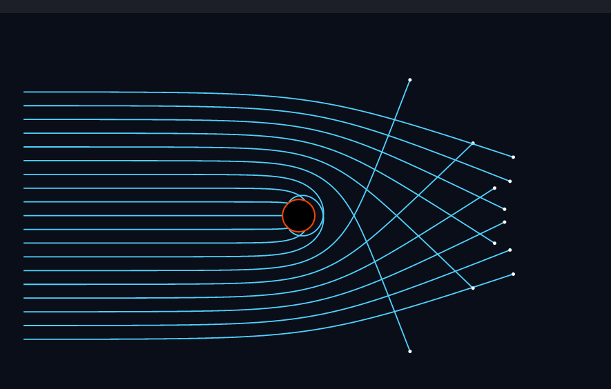

# BlackHoleSim 2D

A small C# simulation of how light bends around a black hole.

I built BlackHoleSim 2D to explore how gravity affects the paths of light rays. You can launch photons, watch their trajectories bend around a black hole, and change its mass to see how the paths respond.

The simulation is a **2D orbital-plane view**, not a realistic image of a black hole as seen through a camera.

## What it does

- Traces light rays around a non-rotating (Schwarzschild) black hole
- Uses fourth-order Runge–Kutta (RK4) integration to update each trajectory
- Shows when rays bend away, escape, or cross the event horizon
- Lets you launch individual rays or a group of 19 rays
- Lets you adjust the Schwarzschild radius with a slider

## Running the project

**Requirements:** Windows and the [.NET 9 SDK](https://dotnet.microsoft.com/en-us/download/dotnet/9.0).

1. Download or clone this repository.
2. Open a terminal in the project folder.
3. Run:

   ```powershell
   dotnet run
   ```

You can also open `BlackHoleSim2D.csproj` in Visual Studio and run it from there.

## Controls

| Control | Action |
| --- | --- |
| **Fire 19 rays** | Resets the scene and launches rays at different heights |
| **Click on the canvas** | Fires a single ray toward the right |
| **Mass slider** | Changes the event-horizon radius and resets the starting rays |
| **Pause / Resume** | Pauses or resumes the simulation |
| **Clear** | Removes all rays |

The orange ring marks the **event horizon**. Blue lines are the paths the photons have taken; white dots show photons that are still moving.
## Visual demo

## How it works

The simulation uses the Schwarzschild light-ray equation:

```text
u'' + u = 1.5 * r_s * u^2
u = 1 / r
```

Here, `r` is the distance from the center and `r_s` is the Schwarzschild radius. Instead of solving the whole path at once, the program advances the ray through small steps using RK4. The paths are then drawn in a Windows Forms window.

The main files are:

- `MainForm.cs` — the window, input controls, and drawing
- `Photon.cs` — position and state of each ray
- `Physics.cs` — the trajectory equation and numerical integration
- `Program.cs` — application entry point

For more about the equation and implementation, see [PROJECT_NOTES.md](PROJECT_NOTES.md).

## Limitations and development notes

This is a small numerical model meant for experimenting, not a scientifically validated ray tracer. It does not model spin, redshift, or 3D gravitational lensing. The black circle represents the event horizon rather than the larger apparent shadow seen in rendered black-hole images.

I used AI assistance for some debugging and part of the code. I've kept this version small so I can study the implementation, make changes, and experiment with the physics more easily.
